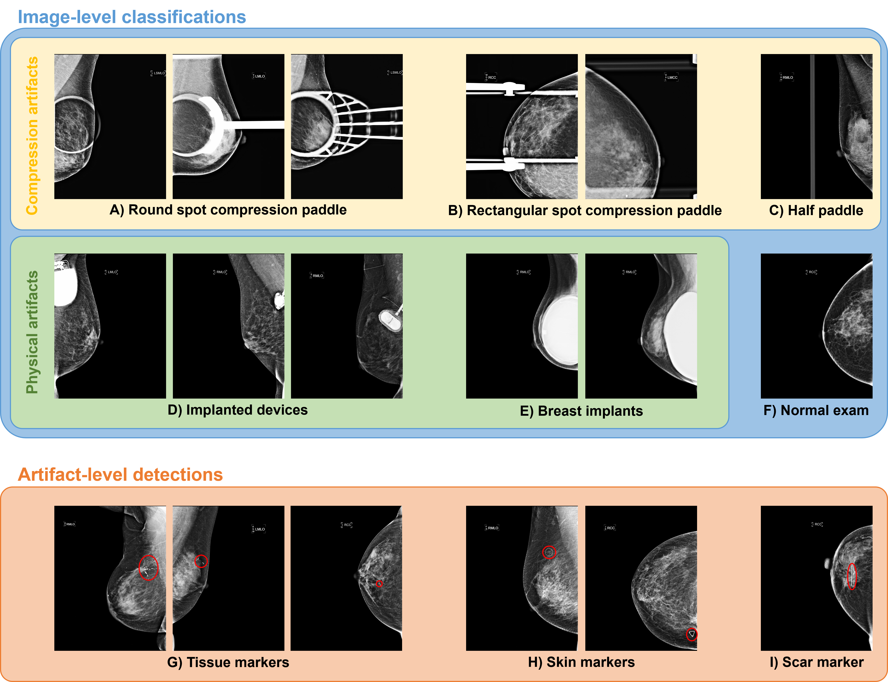

# MammoClean: Open-source detection of imaging artifacts for curating large-scale mammography AI datasets 
---
###### Github repository containing all relevant code for submission - currently under review 

This repository is designed to provide an open-source solution for curating mammography images for ingestion into deep learning pipelines, flagging scans with imaging artifacts not consistently indicated in DICOM metadata. The manuscript is currently under review: preliminary results leading to the submission can be found [here](https://aribunnell.github.io/projects/kanta_elijah_wilson.html). This page will be updated with a link to the manuscript once accepted for publication. 

### Artifact Types Overview:


### Results
Performance on the internal test dataset for identifying each type of scan artifact is described below.
| Characteristic           | Precision | Recall |
|--------------------------|-----------|--------|
| Breast implants          | 0.387     | 0.935  |
| Rect. spot comp. paddles | 0.492     | 0.983  |
| Round spot comp. paddles | 0.643     | 0.964  |
| Half comp. paddles       | 0.897     | 0.963  |
| Implanted devices        | 0.041     | 1.000  |
| Skin markers             | 0.726     | 0.965  |
| Tissue markers           | 0.368     | 1.000  |
| Scar markers             | 0.551     | 0.659  |

## Installation and system requirements
- Tested on Ubuntu 22.04.4 LTS
- Python version: 3.11.15
- To install dependencies, run:
```python3
python setup.py install
```
## Demo
- Demo scripts are provided in the outermost folder.
- Model checkpoint files (as used for results reported in the paper) for the artifact-level detection and round spot compression models can be downloaded from [here](https://drive.google.com/drive/folders/18yLjpbGXGxbmppBxhu9nymLwzgQKcl3B?usp=sharing).
- A demo dataset is provided purely to validate code functionality, the dataset is not representative of the complete dataset used to develop or evaluate pipeline performance in the manuscript. 
- To validate code functionality, run sample code in notebook corresponding to desired functionality.
    - `artifact_model_demo.ipynb` for sample notebook showing detection of skin, tissue, and scar markers using the pretrained deep learning model.  
    - `cv_method_demo.ipynb` for sample notebook showing classification of breast implants, implanted devices, half compression paddles, and rectangular spot compression paddles with traditional CV methods.
    - `spot_comp_model_demo.ipynb` for sample notebook showing classification of round spot compression paddles using the pretrained deep learning model.
    - `cleaned_embed_new_labels.csv` additional labels on a subset of the dataset from the [prior work](https://github.com/biomedia-mira/mammo-artifacts) used for performance evaluation on the EMBED dataset, with compression sub-labels. All credit for initial label curation goes to Schueppert and team. 
    - `sample_dataset.csv` labels, metadata, and filenames for the provided sample data. 
